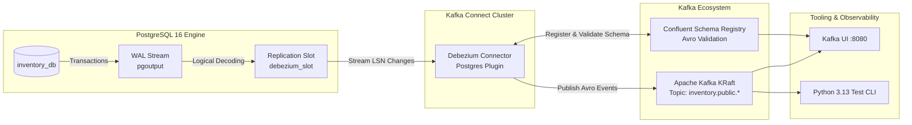

# Production-Grade PostgreSQL CDC with Debezium & Confluent Schema Registry

[](https://www.python.org/)
[-336791.svg)](https://www.postgresql.org/)
[-red.svg)](https://debezium.io/)
[-black.svg)](https://kafka.apache.org/)
[-blue.svg)](https://docs.confluent.io/platform/current/schema-registry/index.html)
[](https://github.com/astral-sh/uv)
[](tests/)

A production-grade laboratory demonstrating modern **Log-Based Change Data Capture (CDC)** from PostgreSQL using **Debezium**, **Apache Kafka (KRaft)**, and **Confluent Schema Registry (Avro)**.

Built specifically to satisfy senior and lead-level engineering assessment criteria for data streaming, logical replication, and schema evolution.

---

## 🏗️ Architecture Overview



---

## 📋 Component Inventory

| Component | Port | Technology / Details |
|---|:---:|---|
| **PostgreSQL 16** | `5432` | `wal_level=logical`, `max_replication_slots=10`, publication `dbz_publication`, `REPLICA IDENTITY FULL` |
| **Apache Kafka** | `9092` / `29092` | Apache Kafka 3.8.0 running in modern **KRaft mode** (no ZooKeeper) |
| **Schema Registry** | `8081` | Confluent Schema Registry 7.7.0 managing Avro schemas (`-key` and `-value`) |
| **Kafka Connect** | `8083` | Confluent Connect 7.7.0 bundled with Debezium PostgreSQL connector plugin |
| **Kafka UI** | `8080` | Web console with direct links to Topics, Avro Schemas, and Connectors |
| **Python Test CLI** | Host | Python 3.13 + `uv` test harness (`src/debezium_cdc_postgres_lab/cli.py`) |

---

## 💡 Lead Engineering Concepts Covered

### 1. Low-Level Logical Replication Mechanics
- **`pgoutput` Logical Decoding:** Debezium utilizes Postgres's native logical decoding plugin, reading row-level changes from the Write-Ahead Log.
- **`REPLICA IDENTITY FULL`:** Configured on source tables so that UPDATE and DELETE events include the complete `before` row image for state transition audits.
- **Replication Slot Durability:** Persistent replication slots ensure Postgres retains WAL records across connector restarts.

### 2. Schema Evolution Handling with Schema Registry
- **Avro Serialization:** Both keys and values are serialized in binary Avro with schema IDs registered in Confluent Schema Registry.
- **Non-Breaking Evolution:** Demonstrates adding optional columns with default values (`ALTER TABLE customers ADD COLUMN loyalty_tier ...`) under `BACKWARD` compatibility.
- **Contract Enforcement:** Schema Registry prevents out-of-band incompatible DDL mutations from corrupting downstream data pipelines.

### 3. Critical Production Gotchas (Interview Runbook)
- **WAL Disk Bloat & Slot Lag:** How stopped or unconsumed replication slots cause `pg_wal/` accumulation and database disk exhaustion, and how `max_slot_wal_keep_size` guards against host crashes.
- **Heartbeat Action Query:** Advancing LSNs on low-traffic tables via periodic heartbeat queries (`heartbeat.action.query`).
- **Signaling Table Incremental Snapshots:** Re-snapshotting historical tables on demand without locking tables or restarting connectors (`debezium_signal`).

---

## 🚀 Quickstart Guide

### 1. Clone & Setup Python 3.13 with `uv`
```powershell
# Install locked dependencies
uv sync

# Run test suite
uv run pytest
```

### 2. Launch Infrastructure (Docker)
```powershell
# Start all containers in the background
docker compose up -d

# Verify all services are healthy
uv run python scripts/verify_infra.py
```

### 3. Run Interactive End-to-End Demo
```powershell
# Executes all 7 lead assessment scenarios automatically
uv run python scripts/run_demo.py
```

### 4. Interactive CLI Scenario Commands
```powershell
# 1. Deploy or inspect connector
uv run cdc connector deploy
uv run cdc connector status

# 2. Seed records and trigger mutations
uv run cdc seed --customers 5 --orders 10
uv run cdc update
uv run cdc delete

# 3. Stream & inspect Avro CDC event envelopes
uv run cdc consume --topic inventory.public.customers

# 4. Inspect PostgreSQL replication slot lag (bytes)
uv run cdc slots

# 5. Schema evolution & ad-hoc snapshots
uv run cdc schema add-col
uv run cdc snapshot --table public.customers
```

---

## 📖 Deep-Dive Documentation
- [System Architecture & Envelope Specification](docs/architecture.md)
- [Operational Runbook & Production Incident Playbooks](docs/operational_runbook.md)
