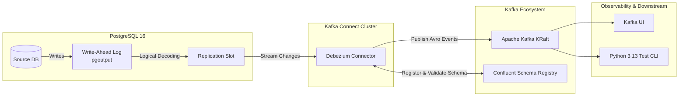

# Debezium PostgreSQL CDC Lab

A production-grade hands-on laboratory and reference architecture for **Log-Based Change Data Capture (CDC)** from PostgreSQL using **Debezium**, **Apache Kafka (KRaft)**, and **Confluent Schema Registry (Avro)**.

Designed specifically to prepare for **Lead/Principal Data & Distributed Systems Engineering** assessments.

---

## 🏗️ Architecture Overview



---

## 🎯 Lead Assessment Objectives Covered

| Category | Real-World Concept Explored |
|---|---|
| **Low-Level Replication** | PostgreSQL `wal_level=logical`, logical decoding plugin (`pgoutput`), publications, and replication slots (`pg_replication_slots`). |
| **Event Envelope Anatomy** | Dissecting Debezium envelopes (`before`, `after`, `op`, `source`, `ts_ms`, `lsn`, `txId`), `REPLICA IDENTITY FULL` vs `DEFAULT`, and tombstone records for compaction. |
| **Schema Evolution** | Handling upstream DDL migrations (adding/dropping/renaming columns) without consumer downtime using Confluent Schema Registry (`BACKWARD`, `FULL` compatibility). |
| **Operational Hazards** | Replication slot lag, unpurged WAL accumulation causing disk exhaustion, heartbeat action queries to advance LSN on low-traffic tables. |
| **Zero-Downtime Snapshots** | Ad-hoc / incremental table snapshots via Debezium signaling tables (`debezium.signals`) without locking tables or restarting connectors. |

---

## 🧰 Tech Stack & Prerequisites

- **Python 3.13+** managed with [`uv`](https://docs.astral.sh/uv/)
- **Docker & Docker Compose** (for Kafka, PostgreSQL, Kafka Connect, Schema Registry)
- **PostgreSQL 16**
- **Debezium PostgreSQL Connector 2.7+**
- **Apache Kafka 3.8+ (KRaft)**
- **Confluent Schema Registry 7.7+**

---

## 🚀 Quickstart Guide

### 1. Python Environment Setup
```powershell
# Verify uv installation and install locked dependencies
uv sync

# Test the scenario CLI
uv run cdc info
```

### 2. Infrastructure Setup (Docker Compose)
*(Coming in Step 2: PostgreSQL, Kafka, Schema Registry, and Kafka Connect)*

---

## 📂 Project Structure

```text
├── docker/                     # Docker Compose & service definitions
│   ├── postgres/               # custom postgresql.conf (wal_level=logical) & init.sql
│   └── connect/                # Kafka Connect image / configuration
├── connectors/                 # Debezium connector registration JSON configs
├── src/debezium_cdc_postgres_lab/ # Python scenario scripts & test harness
│   ├── cli.py                  # Typer CLI entrypoint
│   └── ...
├── docs/                       # In-depth architectural & operational notes
├── pyproject.toml              # Dependencies & package metadata
└── uv.lock                     # Deterministic dependency lockfile
```
