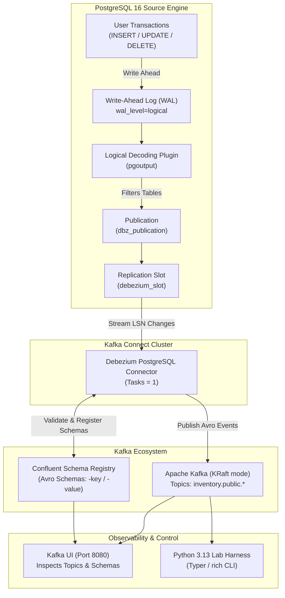

# Debezium PostgreSQL CDC Architecture & Technical Deep-Dive

This document provides a comprehensive technical overview of the log-based Change Data Capture (CDC) platform, detailing PostgreSQL internal replication mechanics, Debezium event envelopes, and schema registry compatibility.

---

## 1. System Architecture

---

## 2. PostgreSQL Logical Replication Mechanics

Unlike trigger-based or query-polling capture (e.g. `SELECT * WHERE updated_at > ?`), log-based CDC reads database mutations directly from the PostgreSQL **Write-Ahead Log (WAL)**.

### A. Key PostgreSQL Prerequistes
1. **`wal_level = logical`**:
   Configures the WAL to record not just physical block changes, but the row-level logical changes necessary for logical decoding.
2. **`pgoutput` Plugin**:
   Standard logical decoding plugin built into PostgreSQL core (no external C extensions needed, unlike legacy `wal2json` or `decoderbufs`).
3. **Publications (`CREATE PUBLICATION dbz_publication FOR ALL TABLES`)**:
   Defines the set of tables whose change streams are emitted into logical decoding.
4. **Logical Replication Slots (`pg_replication_slots`)**:
   Guarantees that the PostgreSQL server will **retain** WAL segments until the consumer (`debezium_slot`) has confirmed consumption via `confirmed_flush_lsn`.

### B. REPLICA IDENTITY (Crucial Lead Interview Concept)
When a row is updated or deleted, what information does the WAL contain about the previous row state?
- **`DEFAULT`** (Postgres default): Only the previous primary key columns are recorded. In Debezium, the `before` field of an UPDATE event will only contain the PK; non-key fields will be `null`.
- **`FULL`** (`ALTER TABLE <tbl> REPLICA IDENTITY FULL`): The entire previous row image is written to the WAL. Debezium can fully populate both `before` and `after` blocks, enabling downstream consumers to compute field-level diffs or audit transitions.

---

## 3. Debezium Event Envelope Specification

Each Kafka CDC event produced by Debezium contains a rich envelope:

### Envelope Fields
| Field | Type | Description |
|---|---|---|
| `op` | String | Operation type: `r` (Snapshot/Read), `c` (Create/Insert), `u` (Update), `d` (Delete), `t` (Truncate). |
| `before` | Record / null | Row state prior to the mutation. Null for Inserts (`c`) and initial snapshots (`r`). |
| `after` | Record / null | Row state after the mutation. Null for Deletes (`d`). |
| `source` | Record | Metadata regarding the source transaction: `lsn`, `txId`, `ts_ms`, `db`, `schema`, `table`, `snapshot`. |
| `ts_ms` | Long | Timestamp (epoch ms) when Debezium processed the event. |
| `transaction` | Record / null | Transaction block metadata when transaction topic tracking is enabled. |

### Tombstone Records for Kafka Log Compaction
When an item is deleted in PostgreSQL:
1. Debezium emits a **DELETE event (`op = 'd'`)** where `before` contains the deleted row and `after = null`.
2. Immediately following, Debezium emits a **Tombstone event** (a record with the same key and `value = null`).
3. This allows Kafka brokers with log compaction (`cleanup.policy=compact`) to eventually delete the key from disk.

---

## 4. Confluent Schema Registry & Schema Evolution

### Schema Naming Strategy
Debezium registers two schemas per topic in Schema Registry:
- `<topic-name>-key`: Defines primary key fields (e.g. `inventory.public.customers-key`).
- `<topic-name>-value`: Defines the full Debezium envelope schema (e.g. `inventory.public.customers-value`).

### Schema Evolution Rules
- **Non-breaking change (Additive with DEFAULT)**:
  `ALTER TABLE customers ADD COLUMN loyalty_tier VARCHAR(20) DEFAULT 'STANDARD';`
  Schema Registry accepts this under `BACKWARD` or `FULL` compatibility because existing consumers without the new field can safely deserialize new messages.
- **Breaking changes**:
  - Renaming columns (Postgres relation update changes field name; Schema Registry treats it as field removal + addition).
  - Adding non-nullable columns without default values.
